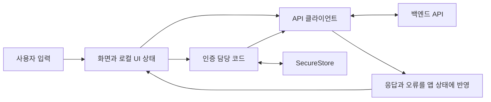

# 프론트 가이드

백엔드 개발 경험을 바탕으로 앱의 실행 흐름을 이해하기 위한 지도다. 현재는 앱 생성 전이다. 아래 개념도는 설명용이며 실제 파일 구조가 아니다. 구현이 생기면 해당 개념에 실제 파일 링크를 연결한다.

## 전체 관계

화면은 입력과 결과를 보여준다. 인증 담당 코드는 로그인 상태와 토큰 수명 주기를 관리한다. API 클라이언트는 HTTP 요청·응답·오류를 다룬다. 백엔드가 인증·인가·데이터 정합성을 최종 보장한다. 구체적인 인증 순서는 [인증 흐름](auth-flow.md)을 따른다.

## 화면과 렌더링

| 개념     | 역할                                             | 로그인 화면에서의 예                          |
|----------|--------------------------------------------------|-----------------------------------------------|
| 컴포넌트 | 화면이나 화면 일부를 구성하는 함수               | 이메일 입력과 제출 버튼을 보여주는 화면       |
| JSX      | 컴포넌트의 구성을 표현하는 문법                  | 입력창·버튼을 어떤 순서로 놓는지 표현         |
| props    | 부모가 자식에게 전달하는 입력                    | 버튼 문구·비활성화 여부·눌렀을 때 실행할 함수 |
| state    | 컴포넌트가 기억하는 값                           | 입력한 이메일, 제출 중 여부, 오류             |
| hook     | React의 상태·외부 동기화 등 기능을 사용하는 함수 | `useState`, `useEffect`, `useContext`         |
| 렌더링   | 현재 props·state로 화면 구성을 계산하는 과정     | 제출 중이면 버튼 문구·활성 상태 변경          |
| 라우팅   | 화면 사이의 이동을 관리                          | 로그인에서 회원가입으로 이동                  |

state 변경은 다음 렌더링을 요청한다. DB transaction처럼 여러 변경의 원자성을 자동 보장하는 기능이 아니다. 요청·토큰 갱신 같은 부수 효과를 렌더링 중 시작하지 않는다. `useEffect`는 외부 시스템과 동기화할 때 사용하며 의존성·정리 동작을 함께 이해한다. 모든 요청을 effect에 넣을 필요는 없고, 제출 요청은 보통 사용자 행동에서 시작한다.

Context는 여러 화면이 같은 인증 상태를 사용할 수 있게 전달하는 기능이다. 기기에 데이터를 영구 저장하는 기능은 아니다.

## 상태의 책임

| 상태        | 예                                 | 수명·원본                                                     |
|-------------|------------------------------------|---------------------------------------------------------------|
| 로컬 UI     | 입력값·오류·제출 중                | 해당 화면에서 관리. 비밀번호는 입력 목적을 넘겨 보관하지 않음 |
| 인증        | 복원 중·비로그인·로그인, 현재 세션 | 인증 담당 코드. 토큰의 보관 방식은 인증 흐름 참조             |
| 서버 데이터 | `/me`의 보호자 유형·찾기 상태 여부      | 서버 응답이 원본. 수정 성공 응답으로 화면을 갱신              |

F1에서는 인증 담당 코드가 `/me` 데이터도 관리할 수 있다. 별도 서버 상태 도구가 생기면 같은 값을 중복 보관하지 않도록 책임을 정한다. 아직 없는 캐시 계층을 미리 만들지 않는다.

## 기술의 역할과 도입 시점

| 기술                              | 맡기는 책임                         | 현재 선택                                                             |
|-----------------------------------|-------------------------------------|-----------------------------------------------------------------------|
| TypeScript                        | JavaScript 값·함수의 타입 검사      | 첫 앱부터 strict 사용. 타입은 실제 HTTP 응답을 런타임에 검증하지 않음 |
| React                             | 상태에 따른 화면 구성               | RN의 기반                                                             |
| React Native                      | iOS 네이티브 화면·기기 API 연결     | `View`, `Text`, `TextInput` 등 기본 컴포넌트 중심                     |
| Expo                              | RN 앱 실행·빌드·기기 기능 도구      | 첫 앱부터. SDK가 지정한 React·RN 버전 조합 사용                       |
| Expo Router                       | 파일 기반 화면 이동·보호 경로       | 화면 이동 단계. 서버 인가를 대체하지 않음                             |
| fetch                             | HTTP 요청                           | API 연결 단계. 작은 클라이언트로 오류·인증 처리 공유                  |
| SecureStore                       | 운영체제 보안 저장소 사용           | 세션 유지 단계. iOS에서는 Keychain 사용                               |
| openapi-typescript                | 백엔드 OpenAPI에서 개발용 타입 생성 | API 연결 단계. 기준 계약을 복제해 별도 편집하지 않음                  |
| Jest·jest-expo·RN Testing Library | 로직·컴포넌트 반응 검사             | 검사할 동작이 생길 때 SDK 호환 조합 설정                              |
| Playwright                        | 실제 HTTP API 흐름 검사             | M1 통합 검증. 네이티브 화면 조작 용도가 아님                          |

TanStack Query는 서버 데이터 조회·캐시·재조회, React Hook Form은 폼 상태, Zod는 런타임 값 검증을 돕는다. 유용하지만 초기 필수 의존성은 아니다. 직접 구현의 복잡성과 비교해 필요한 시점에 도입한다. `@expo/ui/swift-ui`도 초기 중심 구성으로 확정하지 않는다. 일반 RN 레이아웃과 SwiftUI Host 내부의 레이아웃은 규칙이 다르다.

아직 확인하거나 결정하지 않은 도구·환경 항목은 [미결정 사항](decisions.md)에서 관리한다.

## 실행 환경과 실행 방식

초기 기본안은 로컬 Node 26·npm, SDK 57·Expo Go다. SDK·Node·기기 호환성을 앱 생성 직전에 공식 문서로 확인하고, 실제 버전과 lockfile을 고정한다.

| 방식              | 용도·필요 조건                                                                                             |
|-------------------|------------------------------------------------------------------------------------------------------------|
| Expo Go           | 기성 네이티브 실행 앱에서 JS를 실행. 실제 iPhone 첫 화면에 사용. 지원 SDK·포함된 네이티브 기능 제약이 있음 |
| development build | 우리 앱의 네이티브 설정과 개발 도구를 포함한 빌드. F1 완료 전에 실제 저장·권한·재시작 확인                 |
| 로컬 빌드         | Mac의 Xcode로 컴파일. Simulator에는 Xcode·런타임, 실제 기기에는 신뢰·개발자 모드·서명 준비 필요            |
| EAS Build         | 클라우드에서 빌드. 개발 빌드를 만드는 유일한 방법이 아니며 초기 필수 아님                                  |
| TestFlight        | 베타 배포. Apple Developer Program 등 계정·심사 준비는 배포 단계에서 확인                                  |

JS/TS 화면 코드는 Metro가 개발 중 기기로 전달한다. 네이티브 설정·의존성 변경에는 재빌드가 필요할 수 있다. Expo Go 실행 성공만으로 우리 앱의 모든 네이티브 설정을 검증했다고 판단하지 않는다. 현재 단계에서 유료 계정·클라우드 빌드를 시작하지 않는다.

### 실제 iPhone에서 로컬 API 연결

1. Mac과 iPhone을 서로 통신 가능한 같은 LAN에 연결한다.
2. 앱의 API 주소는 Mac의 LAN 주소와 서버 포트를 사용한다. iPhone의 `localhost`는 iPhone 자신이다. iOS Simulator에서는 일반적으로 Mac의 localhost 접근이 가능하지만 실제 요청으로 확인한다.
3. 서버 바인딩·컨테이너 포트 공개·방화벽·서버 기동 상태를 확인한다. 백엔드 설정을 임의로 수정하지 않는다.
4. iOS 로컬 네트워크 권한과 ATS의 HTTP 제한을 확인한다. 필요한 개발 예외는 개발 설정으로 제한하며 배포에서는 HTTPS를 사용한다.
5. Metro 연결과 API 연결을 따로 확인한다. Expo 터널이 로컬 백엔드까지 자동 공개하지는 않는다.

RN 네이티브 HTTP 요청에는 브라우저 CORS 정책이 적용되지 않는다. iOS 권한·ATS·네트워크 경로는 별도다. API 주소는 찾기 상태이며 환경변수에 넣어도 비밀이 되지 않는다. 서버 secret을 앱에 넣지 않는다.

## 테스트의 층

| 층                    | 확인하는 것                              | 확인하지 못하는 것                         |
|-----------------------|------------------------------------------|--------------------------------------------|
| TypeScript·lint       | 타입·정적 코드 규칙                      | 실제 서버 응답·기기 동작                   |
| Jest 로직 테스트      | 실제 인증 코드의 분기·동시성·오류        | OS의 Keychain·키보드                       |
| RN 화면 테스트        | 입력·오류·버튼·화면 상태 변화            | 실제 네이티브 레이아웃·VoiceOver 전체 동작 |
| Playwright API 테스트 | 실제 서버에 요청하여 계약·회전·폐기 검사 | 앱 인증 코드·iOS 화면 조작                 |
| iOS 실행              | 기기 저장·재시작·키보드·접근성·LAN       | 다른 플랫폼 지원 여부                      |

Expo 웹 화면을 실행하면 Playwright로 웹 화면을 조작할 수 있지만 iOS 네이티브 검증은 따로 필요하다. 테스트 때문에 웹 앱이나 네이티브 E2E 도구를 초기부터 추가하지 않는다. M1의 정확한 대응은 [인증 검증](auth-flow.md#검증-기준)을 따른다.
