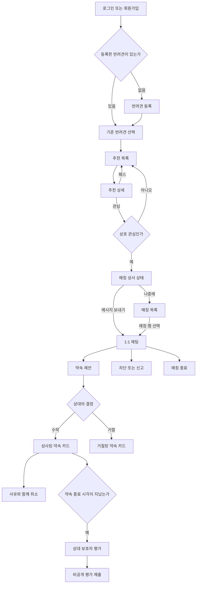

# My Petmate MVP 화면 구조

## 목적과 범위 원칙

이 문서는 iPhone MVP의 화면 동작을 정의한다. 제품 요구는 [백엔드 seed](../../my-petmate-server/docs/seed.yaml), REST 통신은 [OpenAPI](../../my-petmate-server/docs/openapi.yaml), 오류·계정 상태 거부는 [오류 계약](../../my-petmate-server/docs/error-response.md)이 기준이다. 현재 범위·진행은 [MVP 계획](frontend-mvp-plan.md)을 따른다.

전체 와이어프레임의 원본은 [HTML/CSS 화면 자료](design-assets/editable-wireframes/README.md)다. 시각 기준은 [Sunshine 디자인 규칙](ui-foundation.md)을 따른다. Sunshine 적용은 로그인·회원가입·추천 목록·상세·채팅에 한정되며 나머지는 와이어프레임 단계다. 밝은 모드를 사용한다.

- 백엔드 계약에 없는 사용자 기능은 화면에 추가하지 않는다.
- 하나의 보호자 계정은 여러 반려견을 등록할 수 있다.
- 추천, 관심/패스, 매칭, 채팅, 약속은 선택된 한 반려견과 상대 반려견의 쌍을 기준으로 동작한다.
- 정확한 위치와 실시간 위치는 표시하지 않는다. 활동 지역과 근사 거리만 표시한다.
- 궁합은 숫자 퍼센트가 아니라 등급과 사람이 읽을 수 있는 이유로 설명한다.
- 위험하거나 명확히 맞지 않는 후보는 추천 화면에 도달하기 전에 서버에서 제외된다.
- 소셜 로그인, 전화 인증, 푸시 알림, 지도 탐색, 캘린더 연동, 결제, 공개 리뷰·평점, 그룹 산책, 관리자 화면은 포함하지 않는다. 약속 후 비공개 평가는 포함한다.

## 내비게이션 구조

로그인 전에는 인증 스택을 사용한다. 로그인 후에는 네 개의 탭을 사용한다.

이는 전체 MVP의 구조다. F1은 인증·본인 정보·설정과 필요한 탭 셸까지만 제공한다. F2 이전에는 반려견 API로 분기하거나 미구현 기능을 빈 결과로 표시하지 않는다. 복원 중·복원 재시도·정지/탈퇴 안내는 보호 탭 진입 전에 처리한다.

1. 추천
2. 매칭
3. 내 반려견
4. 내 정보

`선택된 반려견`은 프론트의 현재 세션 상태다. 서버에 별도 저장하지 않으며, `dogId`가 필요한 추천·관심·매칭 흐름의 기준으로 사용한다.

## 핵심 사용자 흐름

## 화면 인벤토리

### A. 인증

#### AUTH-01 로그인

- 목적: 이메일과 비밀번호로 토큰을 발급받는다.
- 주요 요소: 이메일, 비밀번호, 로그인, 회원가입 이동.
- API: `POST /api/auth/login`
- 상태: 입력 오류, 인증 실패, 진행 중, 통신·서버 오류, 계정 정지·탈퇴 거부. signup 전용 비밀번호 복잡도 validation을 로그인에 적용하지 않는다.

#### AUTH-02 회원가입

- 목적: 보호자 계정을 생성한다.
- 주요 요소: 이메일, 비밀번호, 비밀번호 확인, 보호자 유형(개인/커플/가족), 개인일 때의 성별, 메이트 찾기 상태, 회원가입.
- API: `POST /api/auth/signup`
- 근거: OpenAPI의 유형별 SignupRequest. DB의 `password_hash`를 클라이언트 필드로 취급하지 않는다. 비밀번호 확인은 필수이며 비밀번호 원문과 정확히 비교한다. 미입력·불일치 시 가입 요청을 보내지 않고 확인 필드 아래에 안내한다. 확인 값은 API 전송·영속 저장·로그에 포함하지 않는다.
- 규칙: 개인을 선택하면 성별은 여성·남성 중 하나를 필수로 선택한다. 커플 또는 가족을 선택하면 성별 입력을 숨긴다. 유형·개인 성별·찾기 상태는 모두 미선택으로 시작한다. 찾기 상태는 찾는 중/쉬는 중이며 제출 전 필수 선택한다. 보호자 정보의 별도 비공개 기능은 없다.
- 상태: 필드 오류, 이미 사용 중인 이메일, 진행 중, 통신·서버 오류, 응답 유실로 가입 결과가 불명확한 상태. 입력 한도·비밀번호 조건은 OpenAPI를 따른다.

> 저장·복원·갱신 순서와 오류 분기는 [인증 흐름](auth-flow.md)을 따른다. 시작 시 보관한 refresh token으로 갱신하고 새 token을 저장한 뒤 `/me`를 조회한다. 일시적 통신 실패와 인증 거부를 구분한다.

#### AUTH-03 복원·계정 상태 안내

- 복원 중에는 로딩 표시와 “안전하게 로그인 상태를 확인하고 있어요.”만 표시하고 로그인·보호 화면을 미리 노출하지 않는다. 실패 시 원인에 맞는 재시도·로그인 경로를 제공한다.
- `ACCOUNT_RESTRICTED`와 `ACCOUNT_WITHDRAWN`은 토큰·개인 상태를 정리하고 보호 영역 밖에서 각각 안내한다. 로그인으로 돌아갈 수 있지만 내 반려견 등 보호 화면으로 이동시키지 않는다.
- 사유·기간·해제 절차는 계약에 없어 표시하지 않는다. 무효 refresh 응답을 계정 상태 오류로 추측하지 않는다.

#### AUTH-04 로그아웃

- F1 본인 정보·설정에서 제공하며 반려견 등록 여부와 무관하게 접근할 수 있다. 실제 반려견 기능 추가 후에는 해당 탭의 설정 진입점을 재사용한다.
- API: `POST /api/auth/logout`. 진행 중 중복 제출을 막고 서버 폐기 시도 후 기기 세션을 정리한다. 서버 확인 실패와 로컬 삭제 실패의 안내·재시도는 [로그아웃 흐름](auth-flow.md#로그아웃)을 따른다.

#### GUARDIAN-02 탈퇴 확인

- F1 본인 정보·설정에서 일반 저장·로그아웃과 분리한 파괴적 행동으로 제공한다.
- 확인 UI에 탈퇴 복구 미지원·접근 종료를 설명하고 취소·탈퇴 확인을 제공한다. 개인정보 즉시 물리 삭제를 약속하지 않는다.
- API: `POST /api/guardians/me/withdraw`. 요청 body 없음. 성공 후 로컬 세션·개인 데이터를 정리한다. 진행 중·실패·결과 불명확·완료를 구분한다.

### B. 내 반려견

#### DOG-01 내 반려견 목록과 기준 선택

- 목적: 등록된 반려견을 조회하고 현재 추천에 사용할 한 마리를 선택한다.
- 주요 요소: 반려견 목록, 현재 선택 표시, 반려견 추가, 행 탭으로 해당 반려견 상세 이동. 보호자 설정·탈퇴·로그아웃은 하단 보호자 정보 탭에서 제공한다.
- API: `GET /api/dogs`
- 상태: 등록된 반려견 없음, 여러 마리, 로딩, 오류.

#### DOG-02 반려견 등록 — 기본 정보

- 목적: 사진과 기본 신원을 입력한다.
- 필드: 사진, 이름, 견종, 만 나이, 성별.
- 나이 규칙: `age` 정수 0~30을 사용하며 1살 미만은 0으로 입력한다.
- 견종 규칙: 서버가 제공하는 견종 목록에서 하나를 선택하며 `믹스견`도 동일한 선택지로 포함한다. 별도 믹스견 토글은 두지 않는다.
- API: 최종 단계에서 `profile` JSON과 `photo`를 multipart로 `POST /api/dogs`

#### DOG-03 반려견 등록 — 신체와 건강

- 목적: 안전 필터와 궁합 계산에 필요한 신체·건강 정보를 입력한다.
- 필드: 몸무게, 크기 그룹, 중성화, 예방접종, 동물등록.
- API: 최종 단계에서 `POST /api/dogs`

#### DOG-04 반려견 등록 — 성향과 행동

- 목적: 사회성과 낯선 반려견 반응을 입력한다.
- 필드: 사회성, 공격성 수준, 선호 산책 강도, 낯선 반려견 반응.
- API: 최종 단계에서 `POST /api/dogs`

#### DOG-05 반려견 등록 — 지역·시간·소개

- 목적: 활동 지역과 함께할 수 있는 시간, 소개를 입력하고 프로필을 생성한다.
- 필드: 주 활동 지역, 근사 위치, 반복 가능한 요일·시작·종료 시간, 자기소개.
- API: `POST /api/dogs`
- 상태: 필수값 누락, 잘못된 시간 범위, 저장 중, 저장 실패.

#### DOG-06 반려견 상세

- 목적: 등록한 반려견의 전체 프로필을 확인한다.
- 주요 요소: 사진, 기본 정보, 건강, 성향, 지역, 가능 시간, 소개, 수정.
- API: `GET /api/dogs/{dogId}`

#### DOG-07 반려견 수정

- 목적: 기존 정보를 수정한다.
- 구조: 등록 화면의 네 단계 폼을 재사용하되 기존 값을 채운다.
- API: `PATCH /api/dogs/{dogId}`, 사진 교체 시 `POST /api/dogs/{dogId}/photos`
- 상태: 저장 중, 필드 오류, 저장 실패, 저장 완료.

#### GUARDIAN-01 내 정보 조회

- 닉네임·선택 사진 자리·유형·성별·찾기 상태를 읽기 전용으로 표시한다. 수정 버튼은 GUARDIAN-EDIT로 이동한다. 로그아웃·탈퇴 확인은 실제 모달로 연다. 하단 네 번째 탭에서 접근한다.

#### GUARDIAN-EDIT 내 정보 수정

- 목적: 보호자 유형·찾기 상태를 변경하고 최초 개인 유형 설정 시 성별을 저장한다.
- 주요 요소: 개인/커플/가족, 개인일 때의 성별, 찾는 중/쉬는 중, 저장. 저장된 성별은 읽기 전용이며 미설정 계정이 처음 개인으로 바뀔 때만 여성/남성을 선택한다.
- API: `GET /api/guardians/me`, `PATCH /api/guardians/me`
- 규칙: 커플 또는 가족이면 성별을 받지 않고 각각 `커플 보호자`, `가족 보호자`로 표시한다. 찾는 중에는 양쪽 찾는 중인 후보를 추천한다. 쉬는 중에는 추천·선제 관심을 중지하고 기존 받은 관심 응답·매칭·채팅·약속은 유지한다.
- 최초 성별은 유형 전환 후에도 서버에 보존된다. 본인 응답의 보존 성별과 상대에게 공개하는 정보는 구분한다. 요청 형태·409·동시 수정은 [인증 흐름](auth-flow.md#내-정보와-수정)을 따른다.
- 상태: 저장 중, validation 오류, 최초 성별 변경 충돌, 저장 실패, 저장 완료. 가입 초기값은 모두 미선택이고 설정은 서버의 현재 값을 표시한다.

### C. 추천과 관심

#### REC-01 추천 목록

- 목적: 선택된 반려견 기준으로 안전 조건을 통과한 후보를 큰 사진 목록에서 비교하고 상세에서 관심·패스를 결정한다.
- 주요 요소: 기준 반려견 전환, 선호 조건, 후보 사진, 이름·기본 정보, 보호자 성별 또는 커플·가족 정보, 궁합 등급, 핵심 이유, 활동 지역, 근사 거리.
- API: 선택된 조건을 query로 전달하는 `GET /api/dogs/{dogId}/recommendations`
- 상태: 추천 없음, 로딩, 재시도 가능한 오류, 쉬는 중. 본인 계정 제한은 AUTH-03에서 처리한다.

#### REC-02 선호 조건 팝업

- 목적: REC-01 위의 작은 모달 창에서 현재 추천 요청에 적용할 선택적 조건을 고른다. 새 페이지로 이동하지 않는다. 닫기·Escape는 적용 없이 돌아가고 적용은 목록을 갱신한다.
- 주요 요소: 크기, 산책 강도, 낯선 반려견 반응, 가능 요일, 읍·면·동 최대 3개, 보호자 정보(여성/남성/커플/가족), 적용, 초기화.
- API: `GET /api/dogs/{dogId}/recommendations`의 `sizeGroups`, `walkIntensities`, `sociabilityLevels`, `availableDays`, `regionIds`, `guardianIdentities` query.
- 규칙: 조건은 앱 세션의 현재 추천 요청에만 적용하며 서버 안전 제외를 완화할 수 없다.
- 규칙: 찾는 중인 보호자는 보호자 정보 필터를 사용할 수 있다. 쉬는 중에는 추천을 요청하지 않고 상태 안내와 찾기 재개 경로를 제공한다. 필터는 받은 관심에 적용하지 않는다.

#### REC-03 추천 상세

- 목적: 후보의 궁합 근거를 읽고 관심 또는 패스를 결정한다.
- 주요 요소: 큰 반려견 사진, 이름·기본 정보, 보호자 성별 또는 커플·가족 정보, 궁합 등급, 전체 추천 이유, 활동 지역, 근사 거리, 보호자가 작성한 반려견 소개 `selfIntroduction`, 산책 가능 시간·조건, 관심, 패스.
- API: 추천 응답 데이터, `POST /api/dogs/{dogId}/likes`
- 상태: 전송 중 버튼 비활성화, 관심 완료, 패스 완료, 중복 요청 오류.

#### REC-04 상호 관심 결과

- 목적: 관심 요청의 응답이 상호 관심으로 매칭을 만들었을 때 결과를 알린다.
- 형태: 별도 영구 화면이 아니라 `REC-03` 위의 결과 시트.
- API 근거: `POST /api/dogs/{dogId}/likes`와 상호 관심 시 `Match` 생성.
- 주요 동작: 채팅으로 바로 이동, 진입한 추천 또는 받은 관심 목록으로 돌아가기.

#### REC-PAUSED 쉬는 중

- 추천 대신 쉬는 중 설명·설정에서 찾기 재개·받은 관심 진입을 제공한다. 기존 대화·약속은 계속 이용할 수 있다.

### D. 매칭과 채팅

#### LIKES-01 받은 관심 목록

- 매칭 탭의 대화/받은 관심 중 받은 관심에서 진입한다. 찾는 중·쉬는 중 모두 사용한다.
- 기준 반려견을 선택하고 큰 사진·이름·보호자 정보·근사 거리·관심 도착 시각을 표시한다.
- API: `GET /api/dogs/{dogId}/received-likes`, `cursor`·`limit`, 응답 `items`·`nextCursor`.
- 추천 선호 필터를 적용하지 않는다. 미처리 관심만 표시하고 처리·매칭·안전 제외 대상은 제거한다.
- 상태: 로딩·빈 결과·실패·재시도·다음 페이지·기준 반려견 전환. 읽음·알림·미확인 배지는 없다.

#### LIKES-02 받은 관심 상세

- 목록 응답의 전체 반려견 프로필·소개·산책 조건을 표시한다. 추천 궁합 등급·이유를 임의 생성하지 않는다.
- API: 기존 `POST /api/dogs/{dogId}/likes`의 liked/passed. 중복 제출을 막는다.
- 양쪽 찾기 상태와 무관하게 기존 관심에 응답한다. 상호 관심이면 REC-04, 패스면 목록으로 돌아간다.
- 실패·안전 상태 변경·이미 처리된 항목은 안내 후 목록을 재조회한다.

#### MATCH-01 매칭 목록

- 목적: 선택된 반려견과 연결된 활성 매칭을 본다.
- 주요 요소: 상대 반려견 사진과 이름, 최근 메시지, 최근 메시지 시각, 읽지 않은 수, 매칭 상태.
- API: `GET /api/matches`
- 상태: 매칭 없음, 로딩, 오류.
- 매칭 탭 상단에 대화/받은 관심 진입점을 제공한다.
- 주요 동작: 매칭 행을 누르면 별도 상세 화면 없이 `CHAT-01`로 바로 이동한다.

#### CHAT-01 1:1 채팅

- 목적: 매칭된 보호자끼리 텍스트와 약속 카드를 교환한다.
- 진입점: `REC-04`의 메시지 보내기 또는 `MATCH-01`의 매칭 행.
- 주요 요소: 상대 반려견 헤더, 메시지 내역, 텍스트 입력, 전송, 약속 제안, 종료된 약속의 평가 진입, 매칭 종료·차단·신고 메뉴.
- API: `GET /api/matches/{matchId}`, cursor 기반 `GET /api/matches/{matchId}/messages`, `POST /api/matches/{matchId}/read`, `WS /ws`
- 메시지 유형: `text`, `appointment_proposal`.
- 헤더 동작: 상대 반려견 이름·사진을 누르면 현재 화면 위에 간단한 매칭 정보 시트를 연다. 별도 상세 페이지는 만들지 않는다.
- 상태: 연결 중, 이전 내역 로딩, 전송 중, 전송 실패, 재연결, 읽음 위치 갱신 실패, 권한 없음, 종료·차단 후 입력 닫힘.

#### MATCH-CLOSE-01 매칭 종료 확인 시트

- 목적: 차단이나 신고 없이 활성 매칭과 채팅을 종료한다.
- 주요 요소: 종료 결과 설명, 취소, 종료 확인.
- API: `POST /api/matches/{matchId}/close`
- 진입점: `CHAT-01`의 더보기 메뉴.
- 완료 후: 채팅에서 이탈하고 활성 매칭 목록에서 제거한다.

### E. 약속

#### APPT-01 약속 제안 시트

- 목적: 채팅 안에서 산책 또는 놀이 약속을 제안한다.
- 필드: 날짜, 시간대, 장소 텍스트.
- API: `POST /api/matches/{matchId}/appointment-proposals`
- 상태: 필드 오류, 전송 중, 전송 실패.

#### APPT-02 제안받은 제안 카드

- 목적: 상대가 보낸 약속을 수락하거나 거절한다.
- 주요 요소: 날짜, 시간대, 장소, 수락, 거절.
- API: `POST /api/appointment-proposals/{proposalId}/accept`, `POST /api/appointment-proposals/{proposalId}/reject`
- 상태: `proposed`, `accepted`, `rejected`.

#### APPT-03 성사된 약속 취소 시트

- 목적: 성사된 약속을 사유와 함께 취소한다.
- 필드: 취소 사유.
- API: `POST /api/appointment-proposals/{proposalId}/cancel`
- 상태: 취소 중, 취소 실패, `canceled`.

#### APPT-04 약속 후 평가 시트

- 목적: 성사된 약속의 종료 시각이 지난 뒤 상대 보호자와 만남 경험을 평가한다.
- 진입점: 채팅 안에서 `reviewEligible=true`, `reviewSubmitted=false`인 종료된 약속 카드의 `평가하기`.
- 필드: 1~5점, 선택적인 경험 태그, 선택적인 한 줄 의견.
- 태그: 시간 약속을 잘 지켰어요, 소통이 배려 깊었어요, 반려견을 안전하게 돌봤어요, 프로필 정보가 정확했어요, 다시 만나고 싶어요.
- API: `POST /api/appointment-proposals/{proposalId}/review`
- 규칙: 참여 보호자별 한 번만 제출하며 자기 자신은 평가할 수 없다. 제안·거절·취소 상태와 종료 전인 약속은 평가할 수 없다.
- 공개 범위: 평가 원문과 집계 점수는 상대 보호자 화면이나 추천 프로필에 공개하지 않는다.
- 상태: 제출 전, 제출 중, 제출 완료, 이미 제출함, 아직 평가할 수 없음.

> `APPT-02`는 독립 페이지가 아니라 채팅 안의 카드 상태들이다. `APPT-01`, `APPT-03`, `APPT-04`만 시트로 열린다.

### F. 안전 조치

#### SAFE-01 차단 확인 시트

- 목적: 상대 보호자를 차단하고 추천·채팅 상호작용을 종료한다.
- 주요 요소: 차단 결과 설명, 취소, 차단 확인.
- API: `POST /api/guardians/{guardianId}/block`
- 진입점: `CHAT-01`의 더보기 메뉴.
- 완료 후: 해당 채팅에서 이탈하고 관련 상호작용을 더 이상 제공하지 않는다.

#### SAFE-02 신고 시트

- 목적: 상대 보호자를 신고한다.
- 주요 요소: 신고 사유, 선택적인 추가 설명, 제출.
- 신고 사유: 부적절한 언어, 괴롭힘, 위협적 행동, 위험한 반려견 관리, 허위 프로필, 약속 불참, 기타.
- 계약 값: `inappropriate_language`, `harassment`, `threatening_behavior`, `unsafe_dog_handling`, `false_profile`, `no_show`, `other`.
- 규칙: 사용자는 severity를 선택하지 않는다. 추가 설명 `comment`는 선택 사항이며 최대 1000자다.
- API: `POST /api/guardians/{guardianId}/reports`
- 진입점: `CHAT-01`의 더보기 메뉴.
- 상태: 제출 중, 제출 실패, 제출 완료.

## 화면이 아닌 공통 상태

아래 항목은 새 기능 화면이 아니라 각 화면에 포함되는 상태다.

- 로딩
- 비어 있음
- 재시도 가능한 서버 오류
- 입력 필드 오류
- 인증 만료 후 로그인 복귀
- 권한 없음
- 네트워크 또는 WebSocket 연결 끊김
- 중복 제출 방지를 위한 진행 중 상태
- REST 오류는 `ProblemDetail.code`로 화면 동작을 결정하고 `detail`을 기본 안내에, `fieldErrors`를 입력 필드에, `requestId`를 문의·로그 추적에 사용한다.
- F1에서 복원 중·통신/저장 장애·인증 거부·서버 오류를 구분한다. 큰 글씨·키보드·스크린리더로도 입력·오류·진행 상태를 확인할 수 있어야 한다. UI Foundation과 [인증 검증](auth-flow.md#검증-기준)을 따른다.

## 여전히 MVP에서 제외하는 화면과 기능

### 보호자 설정과 프로필

본인 정보 설정·탈퇴는 위의 F1 화면에 포함한다. 보호자 닉네임·선택 사진을 표시하고 별도 수정 화면에서 변경한다. 보호자 자기소개·이메일·비밀번호 편집은 만들지 않는다. 성별은 최초 설정·보존 규칙을 따른다.

### 알림 센터

푸시 알림이 MVP 범위 밖이며 알림 조회 API도 없으므로 알림 화면을 만들지 않는다.

### 지도와 장소 검색

정확한 위치 노출과 지도 탐색이 범위 밖이므로 지도 화면을 만들지 않는다. 약속 장소는 텍스트만 입력한다.

### 약속 목록과 캘린더

매칭 탭 안에 대화·받은 관심·약속을 제공한다. 약속 안에는 보낸 제안·받은 제안·성사된 약속·취소된 약속 분류를 둔다. 별도 최상위 약속 탭·캘린더는 추가하지 않는다.

## 와이어프레임 제작 단위

화면 원본·상태별 보기·미리보기는 [HTML/CSS 화면 자료](design-assets/editable-wireframes/README.md)를 기준으로 관리한다. PNG 전체 세트는 유지하지 않는다. SAFE-03은 현재 화면 목록에 포함하지 않는다.

1. `AUTH-01` 로그인
2. `AUTH-02` 회원가입
3. `DOG-01` 반려견 없음
4. `DOG-01` 여러 반려견과 기준 선택
5. `DOG-02~05` 반려견 등록 4단계
6. `DOG-06` 반려견 상세
7. `GUARDIAN-01` 보호자 정보와 찾기 상태
8. `REC-01` 추천 목록
9. `REC-02` 추천 목록 위의 선호 조건 모달
10. `REC-03` 추천 상세
11. `REC-04` 매칭 성사 결과 시트
12. `MATCH-01` 최근 메시지·읽지 않은 수가 있는 매칭 목록
13. `CHAT-01` 매칭 목록·성사 시트에서 바로 진입하는 채팅
14. `MATCH-CLOSE-01` 매칭 종료 시트
15. `APPT-01` 약속 제안 시트
16. `APPT-02~03` 약속 카드와 취소 상태
17. `APPT-04` 약속 후 상대 보호자 평가 시트
18. `SAFE-01~02` 차단·신고 시트
19. `LIKES-01~02` 받은 관심 목록·상세
20. `REC-PAUSED` 쉬는 중 안내
21. `AUTH-03~04`, `GUARDIAN-02` 복원·로그아웃·탈퇴 상태

반려견 수정은 등록 4단계 구조를 재사용하는 구상이다. 현재 이미지에 공통 로딩·오류·키보드·큰 글씨 상태가 충분히 표현되어 있다고 가정하지 않는다.

## 계약 적용 상태

2026-10-22 승인 목표 계약에 맞춘 설계다. 서버의 discoveryStatus와 received-likes는 구현·마이그레이션·검증 대기다. 디자인은 모의 데이터이며 F0·F1 실제 앱 완료 증거가 아니다.

## 화면 흐름 후속 정비

- AUTH 화면은 헤더를 표시하지 않는다. AUTH-STORAGE 독립 화면은 제거하고 저장 실패는 해당 인증 동작 안의 일반 오류 안내로 다룬다. 내부 저장·정리·재시도 보장은 인증 흐름을 유지한다.
- DOG-EDIT 중간 화면은 제거한다. 상세의 수정 버튼 → 기존 값이 채워진 DOG-02~05 → 수정 완료 → 상세. 생성 POST /api/dogs, 수정 PATCH /api/dogs/{dogId}, 사진 교체 POST /api/dogs/{dogId}/photos를 구분한다.
- AUTH-04·GUARDIAN-02·MATCH-CLOSE-01·SAFE-01은 페이지가 아닌 확인 모달이다. REC-SENT는 일반 관심 전송 성공 모달, REC-04는 상호 관심 결과 모달이다.
- CHAT-01 우측 채팅 설정은 CHAT-SETTINGS 모달을 열어 매칭 종료·차단·신고를 제공한다. 전역 보호자 정보 설정과 구분한다.

## APPT-LIST 매칭 탭의 약속 목록

- 매칭 → 약속 → 보낸 제안/받은 제안/성사된 약속/취소된 약속의 두 단계 탭 구조다.
- 보낸 제안과 받은 제안은 proposed·rejected 항목을 제안 방향으로 분류한다. 성사된 약속은 방향과 무관한 accepted 항목을 모은다. 취소된 약속은 방향과 무관하게 모으며 취소 사유를 함께 표시한다.
- GET /api/appointment-proposals?box=sent|received|accepted|canceled의 items·nextCursor를 사용한다. 카테고리 변경 시 cursor를 초기화한다.
- 받은 제안의 수락·거절과 수락 약속의 취소는 기존 명령 API를 사용한다. 성공 후 목록을 재조회하고 채팅 카드도 같은 서버 상태로 갱신한다.
- APPT-02는 채팅 안의 받은 제안 카드로 확인한다. 별도 독립 페이지로 이동하지 않는다. 목록에서도 같은 카드·동작을 사용한다.
- 빈 결과·로딩·실패·재시도·다음 페이지를 구분하며 기존 참여 권한과 종료·차단 제한을 우회하지 않는다.

## 평가·내 정보·프로필 표시 정비

만남 경험은 별 1~5개로 선택한다. 반 개·0점은 없고 서버에는 기존 rating 정수 1~5를 전송한다. 화면·탭 명칭은 내 정보로 통일한다. REC-01·03은 guardian.nickname·선택 guardian.photoUrl과 guardianIdentity를 표시한다. 성사된 약속은 약속 목록의 accepted 분류에서 확인·취소할 수 있다.

### 채팅 시나리오 예시

CHAT-01: 구름에게 내가 제안 → 상대 수락 → 상대 취소·사유 표시. CHAT-02: 두부에게 제안받음 → 내가 수락 → 성사된 약속 표시. 각 채팅은 해당 match의 약속만 표시하며 매칭·약속 목록에서 해당 대화로 이동한다. 두 예시는 같은 실제 채팅 화면의 서로 다른 데이터 상태다.

### 채팅·성별·지역 변경 (2026-10-22)

- 지역은 시도 → 시군구 → 읍면동 중 최종 읍면동만 최대 3개 선택한다. 선택 지역끼리는 OR, 다른 조건과는 AND다. 미선택은 지역 제한 없음이다. 근사 거리 표시는 유지한다. `GET /api/regions` 카탈로그와 추천 `regionIds`를 사용한다.
- 개인 가입 성별 제목은 성별, 안내는 “한 번 설정한 성별은 바꿀 수 없어요.”다. 내 정보 수정도 제목은 성별이며 기존 안내를 유지한다. 커플·가족에서는 성별과 안내를 함께 숨긴다.
- 구름 채팅: 보낸 제안 → 성사된 약속 → 취소된 약속 카드 3개와 사이 대화. 두부 채팅: 받은 제안 → 성사된 약속 카드 2개. 과거 카드에 응답 버튼을 두지 않고 목록에는 최신 상태만 표시한다. 실제 채팅 이력 이벤트 계약은 F6에서 확인한다.
