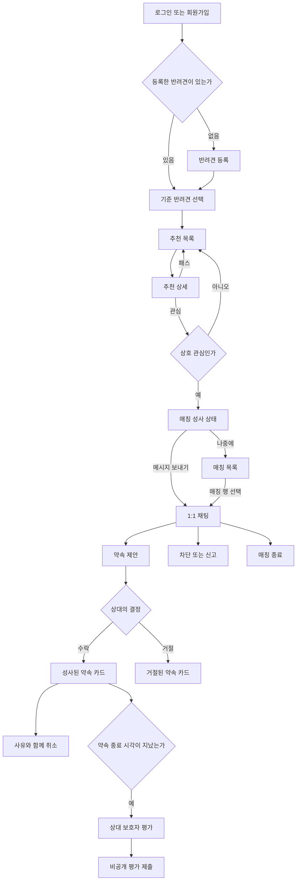

# My Petmate MVP 화면 정의

## 목적과 범위 원칙

이 문서는 iPhone MVP의 화면 동작을 정의한다. 제품 요구는 [백엔드 seed](../../my-petmate-server/docs/seed.yaml), REST
통신은 [OpenAPI](../../my-petmate-server/docs/openapi.yaml), 오류·계정 상태
거부는 [오류 계약](../../my-petmate-server/docs/error-response.md)이 기준이다. 현재 범위·진행은 [MVP 계획](frontend-mvp-plan.md)을 따른다.

전체 와이어프레임의 원본은 [HTML/CSS 화면 자료](design-assets/editable-wireframes/README.md)다. 시각
기준은 [Sunshine 디자인 규칙](ui-foundation.md)을 따른다. Sunshine은 F1 전체 화면·탭 셸과 기존 F3 추천 목록·상세·F5 채팅 (F6 약속 카드)에 적용하며 나머지는 와이어프레임
단계다. 밝은 모드를 사용한다.

- 백엔드 계약에 없는 사용자 기능은 화면에 추가하지 않는다.
- 하나의 보호자 계정은 여러 반려견을 등록할 수 있다.
- 추천, 관심/패스, 매칭, 채팅, 약속은 선택된 한 반려견과 상대 반려견의 쌍을 기준으로 동작한다.
- 활동 지역·가능 시간은 보호자 정보다. 산책 강도·낯선 반려견 반응은 반려견 정보다. MVP는 좌표 입력·저장·거리 계산·표시를 제공하지 않는다.
- 궁합은 숫자 퍼센트가 아니라 등급과 사람이 읽을 수 있는 이유로 설명한다.
- 위험하거나 명확히 맞지 않는 후보는 추천 화면에 도달하기 전에 서버에서 제외된다.
- 소셜 로그인, 전화 인증, 푸시 알림, 지도 탐색, 캘린더 연동, 결제, 공개 리뷰·평점, 그룹 산책, 관리자 화면은 포함하지 않는다. 약속 후 비공개 평가는 포함한다.

## 내비게이션 구조

로그인 전에는 인증 스택을 사용한다. 로그인 후에는 네 개의 탭을 사용한다.

이는 전체 MVP의 구조다. F1은 인증·본인 정보·설정과 필요한 탭 셸까지만 제공한다. F2 이전에는 반려견 API로 분기하거나 미구현 기능을 빈 결과로 표시하지 않는다. 복원 중·복원 재시도·정지/탈퇴 안내는
보호 탭 진입 전에 처리한다.

1. 추천
2. 매칭
3. 내 반려견
4. 내 정보

`선택된 반려견`은 프론트의 현재 세션 상태다. 서버에 별도 저장하지 않으며, `dogId`가 필요한 추천·관심·매칭 흐름의 기준으로 사용한다.

## 핵심 사용자 흐름

## 화면 인벤토리

### 공통 항목

다음은 여러 화면에서 공유하는 탐색·상태·처리 기준이다. 각 화면에 해당하는 항목만 적용하며, 화면별 특별한 상태와 복구 동작은 각 인벤토리에 둔다.

- 탐색: 로그인 전 인증 스택과 로그인 후 네 탭은 [내비게이션 구조](#내비게이션-구조)를 따른다. 인증 화면에는 헤더를 표시하지 않는다.
- 로딩
- 비어 있음
- 재시도 가능한 서버 오류
- 입력 필드 오류
- 인증 만료 후 로그인 복귀
- 권한 없음
- 네트워크 또는 WebSocket 연결 끊김
- 중복 제출 방지를 위한 진행 중 상태
- REST 오류는 `ProblemDetail.code`로 화면 동작을 결정하고 `detail`을 기본 안내에, `fieldErrors`를 입력 필드에, `requestId`를 문의·로그 추적에 사용한다.
- 복원 중·통신/저장 장애·인증 거부·서버 오류를 구분한다. 큰 글씨·키보드·스크린리더로도 입력·오류·진행 상태를 확인할 수 있어야 한다. UI
  Foundation과 [인증 검증](auth-flow.md#검증-기준)을 따른다.

### A. F1 인증과 내 정보

F1은 아래 사용자 흐름과 추천·매칭·내 반려견 탭 셸을 제공한다. 토큰 저장·복원·갱신과 오류 처리의 상세 기준은 [인증 흐름](auth-flow.md), 요청·응답은 [OpenAPI](../../my-petmate-server/docs/openapi.yaml)를 따른다.

#### AUTH-01 로그인

- 사용자 목표: 계정으로 로그인해 서비스를 이용한다.
- 시작 조건: 로그인하지 않은 사용자가 로그인 화면을 연다.
- 기본 흐름:
  1. 이메일과 비밀번호를 입력하고 로그인한다.
  2. 로그인 진행 상태를 표시하고 `POST /api/auth/login`을 요청한다.
  3. 세션 저장을 완료한 뒤 추천 탭 셸로 이동한다.
- 다른 흐름:
  - 필수 입력 오류는 해당 필드 가까이에 안내한다.
  - 인증 실패, 통신·서버 오류, 세션 저장 실패는 모달로 안내한다. 저장 실패 시 보호 화면으로 이동하지 않는다.
  - 계정이 정지되었거나 탈퇴한 경우 상태에 맞게 안내한다.
  - 회원가입을 선택하면 가입 화면으로 이동한다.
- 관련 화면: AUTH-01, AUTH-02, F1-REC.
- 상세 계약: [로그인과 회원가입](auth-flow.md#로그인과-회원가입), [오류 분기](auth-flow.md#자동-갱신과-오류-분기).

#### AUTH-02 회원가입

- 사용자 목표: 보호자 계정을 만들고 서비스를 시작한다.
- 시작 조건: 로그인하지 않은 사용자가 회원가입을 선택한다.
- 기본 흐름:
  1. 닉네임·이메일·비밀번호·비밀번호 확인, 보호자 유형과 찾기 상태를 입력한다. 개인 유형은 성별도 선택한다. 주 활동 지역 1~3개와 활동 가능한 요일·시간을 필수로 설정한다.
  2. 지역은 가입 전 공개 카탈로그에서 시도→시군구→읍면동으로 선택한다. 하나의 입력 영역에서 요일·시간을 정하고 추가하기를 누르면 아래 한 줄 시간 목록에 추가된다. 입력은 초기화되고 각 행의 삭제 버튼으로 제거한다. 시간 설정 오류는 확인 버튼이 있는 안내 패널로 표시하고, 확인·Escape로 닫아도 선택한 요일·시간과 추가 목록을 유지한다.
  3. 회원가입을 제출하면 진행 상태를 표시하고 `POST /api/auth/signup`을 요청한다.
  4. 가입과 세션 저장을 완료한 뒤 추천 탭 셸로 이동한다.
- 다른 흐름:
  - 필수 입력 누락이나 비밀번호 불일치는 해당 필드에 안내한다. 유형·개인 성별·찾기 상태·지역·요일은 미선택으로 시작한다. 지역/시간대 누락·지역 중복/상한·시간 역전/겹침은 해당 입력에 안내한다.
  - 중복 이메일은 이메일 필드에 안내한다. 서버 오류는 재시도를 안내한다.
  - 응답 유실로 가입 결과를 확인하지 못하면 결과가 불명확함을 안내하고 로그인 화면에서 확인하도록 한다.
  - 가입 후 세션 저장이 실패하면 복구 또는 재로그인을 안내한다.
- 관련 화면: AUTH-01, AUTH-02, F1-REC.
- 상세 계약: [로그인과 회원가입](auth-flow.md#로그인과-회원가입), OpenAPI의 유형별 가입 요청.

#### AUTH-03 로그인 상태 복원과 인증 안내

- 사용자 목표: 앱을 다시 열었을 때 로그인 상태를 확인하고 서비스를 이어서 이용한다.
- 시작 조건: 사용자가 앱을 실행한다.
- 기본 흐름:
  1. 로그인 상태를 확인하는 동안 공통 복원 스피너를 표시한다.
  2. 저장된 세션으로 갱신하고 현재 사용자 정보를 조회한다.
  3. 확인이 끝나면 인증된 화면으로 이동한다.
- 다른 흐름:
  - 저장된 세션이 없으면 로그인 화면으로 이동한다.
  - 기기 저장소·통신·사용자 정보 조회 실패는 원인에 맞게 재시도 또는 재로그인을 안내한다.
  - 세션이 유효하지 않으면 로그인 화면으로 이동한다. 계정 정지·탈퇴는 상태에 맞게 로그인 화면에서 안내한다.
  - 확인 중이나 복구가 필요한 상태에서는 보호 화면에 진입하지 않는다.
- 관련 화면: AUTH-03 공통 복원 상태, AUTH-01, F1 탭 셸.
- 상세 계약: [앱 시작과 복원](auth-flow.md#앱-시작과-복원), [오류 분기](auth-flow.md#자동-갱신과-오류-분기).

#### GUARDIAN-01 내 정보 조회

- 사용자 목표: 현재 보호자 정보·찾기 상태·활동 지역과 가능한 요일·시간을 확인한다.
- 시작 조건: 로그인한 사용자가 내 정보 탭을 선택한다.
- 기본 흐름:
  1. 현재 사용자 정보를 조회하고 진행 상태를 표시한다.
  2. 닉네임·선택 사진·보호자 유형·성별·찾기 상태·주 활동 지역·활동 가능한 요일과 시간을 읽기 전용으로 표시한다.
  3. 수정·로그아웃·탈퇴 중 원하는 행동을 선택할 수 있다.
- 다른 흐름:
  - 조회에 실패하면 안내하고 재시도를 제공한다.
  - 계정 정지·탈퇴 또는 인증 거부는 상태에 맞는 인증 안내로 연결한다.
- 관련 화면: GUARDIAN-01, GUARDIAN-EDIT, AUTH-04, GUARDIAN-02.
- 상세 계약: `GET /api/guardians/me`, [인증 흐름](auth-flow.md#내-정보와-수정).

#### GUARDIAN-EDIT 내 정보 수정

- 사용자 목표: 닉네임·사진·보호자 유형·찾기 상태·주 활동 지역·활동 가능한 요일과 시간을 변경한다.
- 시작 조건: 로그인한 사용자가 내 정보에서 수정을 선택한다.
- 기본 흐름:
  1. 서버에 저장된 정보를 입력값으로 표시한다.
  2. 지역·시간은 가입과 같은 선택기를 사용해 수정한다. 내 정보에서는 지역별·시간대별로 줄을 나눠 표시한다. 지역·시간 목록은 전체 교체하고 다른 수정 필드와 함께 저장한다. 사진은 촬영 또는 앨범에서 선택해 미리 볼 수 있다.
  3. 저장이 완료되면 확인된 정보를 반영하고 내 정보로 이동한다.
- 다른 흐름:
  - 취소하면 수정 내용을 제출하지 않고 내 정보로 돌아간다.
  - 입력 오류 또는 저장 실패는 안내하고 수정할 수 있도록 한다.
  - 동시에 변경된 정보가 충돌하면 안내 후 최신 정보를 다시 확인한다.
  - 정보는 저장됐지만 사진 업로드가 실패하면 저장된 범위를 구분해 안내한다.
  - 저장된 성별은 읽기 전용이다. 성별이 없는 계정이 처음 개인 유형으로 바뀔 때 성별을 선택한다.
- 관련 화면: GUARDIAN-01, GUARDIAN-EDIT.
- 상세 계약: `GET /api/guardians/me`, `PATCH /api/guardians/me`, 사진 업로드 API, [내 정보와 수정](auth-flow.md#내-정보와-수정).

#### AUTH-04 로그아웃

- 사용자 목표: 현재 기기에서 로그인 상태를 종료한다.
- 시작 조건: 로그인한 사용자가 내 정보에서 로그아웃을 선택한다.
- 기본 흐름:
  1. 확인 화면에서 로그아웃을 선택한다.
  2. 진행 상태를 표시하고 서버 세션 폐기와 기기 세션 정리를 시도한다.
  3. 기기 정리가 완료되면 로그인 화면으로 이동한다.
- 다른 흐름:
  - 취소하면 내 정보로 돌아간다.
  - 서버 폐기를 확인하지 못한 경우와 기기 삭제가 실패한 경우를 구분해 안내한다. 기기 삭제 실패 시 재시도를 제공한다.
- 관련 화면: GUARDIAN-01, AUTH-04 확인 모달, AUTH-01.
- 상세 계약: `POST /api/auth/logout`, [로그아웃 흐름](auth-flow.md#로그아웃).

#### GUARDIAN-02 탈퇴 확인

- 사용자 목표: 계정 이용을 종료한다.
- 시작 조건: 로그인한 사용자가 내 정보에서 탈퇴를 선택한다.
- 기본 흐름:
  1. 계정 접근 종료와 복구 미지원 안내를 확인하고 탈퇴를 선택한다.
  2. 진행 상태를 표시하고 탈퇴를 요청한다.
  3. 서버 성공 후 기기 세션과 개인 상태를 정리하고 로그인 화면으로 이동한다.
- 다른 흐름:
  - 취소하면 내 정보로 돌아간다.
  - 요청이 거부되면 안내한다. 통신 실패나 서버 오류로 결과가 불명확하면 확인·재시도 경로를 제공한다.
  - 탈퇴 성공 후 기기 정리에 실패하면 탈퇴 결과와 정리 실패를 구분해 안내하고 정리를 재시도한다.
- 관련 화면: GUARDIAN-01, GUARDIAN-02 확인 모달, AUTH-01.
- 상세 계약: `POST /api/guardians/me/withdraw`, [탈퇴와 계정 상태](auth-flow.md#탈퇴와-계정-상태).

#### F1 탭 셸

- 사용자 목표: 인증된 상태에서 원하는 탭으로 이동한다.
- 시작 조건: 로그인 또는 세션 복원을 완료한다.
- 기본 흐름:
  1. 추천·매칭·내 반려견·내 정보 중 탭을 선택한다.
  2. 내 정보는 조회 화면을 표시하고, 후속 기능 탭은 준비 중 안내를 표시한다.
- 다른 흐름:
  - 인증 상태를 확인할 수 없거나 계정 접근이 거부되면 인증 안내로 이동한다.
- 관련 화면: F1-REC, F1-MATCH, F1-DOG, GUARDIAN-01.
- 상세 기준: [내비게이션 구조](#내비게이션-구조), [인증 흐름](auth-flow.md).

### B. 내 반려견

#### DOG-01 내 반려견 목록과 기준 선택

- 목적: 등록된 반려견을 조회하고 현재 추천에 사용할 한 마리를 선택한다.
- 주요 요소: 반려견 목록, 현재 선택 표시, 반려견 추가, 행 탭으로 해당 반려견 상세 이동. 보호자 설정·탈퇴·로그아웃은 하단 보호자 정보 탭에서 제공한다.
- API: `GET /api/dogs`
- 상태: 등록된 반려견 없음, 여러 마리.

#### DOG-02 반려견 등록 — 기본 정보

- 목적: 사진과 기본 신원을 입력한다.
- 필드: 사진, 이름, 견종, 생년월일, 성별. 견종이 기타이면 바로 아래에 선택적인 견종명 입력을 표시한다. 생년월일과 자유 견종명은 HTML 초안에서 유지한다. 나이는 생년월일에서 계산해 표시한다. 서버는 아직
  age와 견종 코드만 받으며 계약 검토와 연동 과제는 [프론트 기술 부채](technical-debt.md)를 따른다.
- 성별 표시는 암컷·수컷으로 구분하며 계약 값 `female`·`male`은 그대로 사용한다.
- 나이 규칙: `age` 정수 0~30을 사용하며 1살 미만은 0으로 입력한다.
- 견종 규칙: 서버가 제공하는 견종 목록에서 하나를 선택하며 `믹스견`도 동일한 선택지로 포함한다. 별도 믹스견 토글은 두지 않는다.
- API: 최종 단계에서 `profile` JSON과 `photo`를 multipart로 `POST /api/dogs`

#### DOG-03 반려견 등록 — 신체와 건강

- 목적: 안전 필터와 궁합 계산에 필요한 신체·건강 정보를 입력한다.
- 필드: 몸무게, 크기 그룹, 중성화, 예방접종, 동물등록.
- API: 최종 단계에서 `POST /api/dogs`

#### DOG-04 반려견 등록 — 성향과 행동

- 목적: 선호 산책 강도와 낯선 반려견 반응을 입력한다.
- 필드: 선호 산책 강도, 낯선 반려견 반응.
- API: 최종 단계에서 `POST /api/dogs`

#### DOG-05 반려견 등록 — 소개

- 목적: 반려견 소개를 입력하고 프로필을 생성한다.
- 필드: 자기소개. 활동 지역·시간은 보호자 정보에서 공유하며 이 폼에서 입력·수정하지 않는다.
- API: `POST /api/dogs`
- 상태: 필수값 누락, 저장 중, 저장 실패.

#### DOG-06 반려견 상세

- 목적: 등록한 반려견의 전체 프로필을 확인한다.
- 주요 요소: 사진, 기본 정보, 건강, 성향, 소개, 수정. 공유 활동 지역·시간은 보호자 정보에서 확인·수정한다.
- API: `GET /api/dogs/{dogId}`

#### DOG-07 반려견 수정

- 목적: 기존 정보를 수정한다.
- 구조: 등록 화면의 네 단계 폼을 재사용하되 기존 값을 채운다.
- API: `PATCH /api/dogs/{dogId}`, 사진 교체 시 `POST /api/dogs/{dogId}/photos`
- 상태: 저장 중, 필드 오류, 저장 실패, 저장 완료.

### C. 추천과 관심

#### REC-01 추천 목록

- 목적: 선택된 반려견 기준으로 안전 조건을 통과한 후보를 큰 사진 목록에서 비교하고 상세에서 관심·패스를 결정한다.
- 주요 요소: 기준 반려견 전환, 선호 조건, 후보 사진, 이름·기본 정보, 보호자 성별 또는 커플·가족 정보, 궁합 등급, 핵심 이유, 보호자의 활동 지역·가능 시간.
- 찾기 상태 변경은 다음 추천·관심 요청부터 적용된다. 기존 받은 관심 응답과 매칭·채팅·약속은 유지한다.
- 기본 진입: 필터 없이 요청한다. 서버가 저장된 보호자 지역·시간과 선택 반려견 성향으로 추천한다. 활동 지역 교집합과 실제 시간 겹침이 있는 후보에 궁합·시간 근거를 표시한다.
- API: `GET /api/dogs/{dogId}/recommendations`. 임시 조건만 query로 전송하며 실효 조건은 응답의 `appliedFilters`를 사용한다.
- 결과 부족: 지역·시간·조건 조정이나 내 정보 수정 경로를 제공하며 자동으로 범위를 넓히지 않는다.
- 상태: 추천 없음, 쉬는 중. 본인 계정 제한은 인증 안내 모달에서 안내한다.

#### REC-02 선호 조건 팝업

- 목적: REC-01 위의 작은 모달 창에서 현재 추천 요청에 적용할 선택적 조건을 고른다. 새 페이지로 이동하지 않는다. 닫기·Escape는 적용 없이 돌아가고 적용은 목록을 갱신한다.
- 주요 요소: 크기, 산책 강도, 낯선 반려견 반응, 가능 요일·시작/종료 시간, 읍·면·동 최대 3개, 보호자 정보 (여성/남성/커플/가족), 적용, 초기화.
- API: `GET /api/dogs/{dogId}/recommendations`의 `sizeGroups`, `walkIntensities`, `unfamiliarDogReactions`,
  `availableTimeSlots`, `regionIds`, `guardianIdentities` query. 시간대는 JSON 배열을 URL 인코딩해 전송한다.
- 규칙: 크기·산책 강도·낯선 반려견 반응·보호자 정보는 그룹별 단일 선택이다. 지역·요일/시간은 각각 ‘저장 정보 사용’과 ‘이번 조건 지정’을 선택한다. 지정한 차원은 저장값을 대체하고 다른 조건은 함께 적용한다. 지역 선택 순서는 우선순위가 아니다.
- 규칙: 조건은 현재 앱 세션의 추천 조회에만 적용하며 프로필을 수정하지 않는다. 초기화 후 적용하면 임시 조건을 모두 제거하고 저장 정보 기반 추천으로 돌아간다. 닫기·Escape는 초안을 버리고 기존 적용 조건을 유지한다. 기본 추천과 필터는 무료이며 안전 제외를 완화할 수 없다.
- 규칙: 찾는 중인 보호자는 보호자 정보 필터를 사용할 수 있다. 쉬는 중에는 추천을 요청하지 않고 상태 안내와 찾기 재개 경로를 제공한다. 필터는 받은 관심에 적용하지 않는다.

#### REC-03 추천 상세

- 목적: 후보의 궁합 근거를 읽고 관심 또는 패스를 결정한다.
- 주요 요소: 큰 반려견 사진, 이름·기본 정보, 보호자 성별 또는 커플·가족 정보, 궁합 등급, 전체 추천 이유, 보호자의 활동 지역·가능 시간, 보호자가 작성한 반려견 소개 `selfIntroduction`, 산책
  가능 시간·조건, 관심, 패스.
- API: 추천 응답 데이터, `POST /api/dogs/{dogId}/likes`
- 상태: 전송 중 버튼 비활성화, 관심 완료, 패스 완료, 중복 요청 오류.

#### REC-04 상호 관심 결과

- 목적: 관심 요청의 응답이 상호 관심으로 매칭을 만들었을 때 결과를 알린다.
- 형태: 별도 영구 화면이 아니라 `REC-03` 위의 결과 시트.
- API 근거: `POST /api/dogs/{dogId}/likes`와 상호 관심 시 `Match` 생성.
- 주요 동작: 채팅으로 바로 이동, 진입한 추천 또는 받은 관심 목록으로 돌아가기.

#### REC-PAUSED 쉬는 중

- 추천 대신 쉬는 중 설명·설정에서 찾기 재개·받은 관심 진입을 제공한다. 기존 대화·약속은 계속 이용할 수 있다.

### D. 매칭과 채팅

#### LIKES-01 받은 관심 목록

- 매칭 탭의 대화/받은 관심 중 받은 관심에서 진입한다. 찾는 중·쉬는 중 모두 사용한다.
- 기준 반려견을 선택하고 작은 사진·이름·관심 도착 시각의 축약 카드를 표시한다. 카드 본문은 REC-03의 공통 상세 레이아웃으로 이동하고, 카드 안에서도 수락·거절할 수 있다. 행동 버튼은 상세 링크 밖에
  둔다.
- API: `GET /api/dogs/{dogId}/received-likes`, `cursor`·`limit`, 응답 `items`·`nextCursor`.
- 추천 선호 필터를 적용하지 않는다. 미처리 관심만 표시하고 처리·매칭·안전 제외 대상은 제거한다.
- 상태: 로딩·빈 결과·실패·재시도·다음 페이지·기준 반려견 전환. 읽음·알림·미확인 배지는 없다.

#### LIKES-02 받은 관심 상세

- REC-03의 공통 상세 레이아웃을 사용한다. LIKES-02 진입도 같은 렌더러로 연결한다. 받은 관심 문맥에서는 수락·거절을 제공하고 목록 응답의 전체 반려견 프로필·소개·산책 조건·보호자 정보를 표시한다.
  추천 궁합 등급·이유를 임의 생성하지 않는다. 활동 지역·시간은 공개 보호자 정보에서 읽는다.
- API: 기존 `POST /api/dogs/{dogId}/likes`의 liked/passed. 중복 제출을 막는다.
- 양쪽 찾기 상태와 무관하게 기존 관심에 응답한다. 상호 관심이면 REC-04, 패스면 목록으로 돌아간다.
- 실패·안전 상태 변경·이미 처리된 항목은 안내 후 목록을 재조회한다.

#### LIKES-SENT 보낸 관심 목록

- 목적: 기준 반려견이 보낸 관심과 응답 대기 상태를 확인하고 취소한다.
- 진입점: 매칭 내부의 보낸 관심 탭. 대화·받은 관심·보낸 관심·약속의 네 이동 탭을 공유한다.
- 모의 동작: 기준 반려견별로 목록을 분리하며 관심을 보내면 중복 없이 추가한다. 오른쪽 X로 관심을 취소해 해당 행을 제거하며 X 이외의 행 영역은 반려견 상세로 이동한다. 새로고침하면 초기화된다.
- 계약 확인 필요: 현재 OpenAPI에는 보낸 관심 조회·취소 API가 없다. HTML 시안에서만 제공하며 F4 앱 구현 전 계약을 별도로 결정한다.

#### MATCH-01 매칭 목록

- 목적: 선택된 반려견과 연결된 활성 매칭을 본다.
- 주요 요소: 상대 반려견 사진과 이름, 최근 메시지, 최근 메시지 시각, 읽지 않은 수, 매칭 상태.
- API: `GET /api/matches`
- 상태: 매칭 없음.
- 매칭 탭 상단에 대화/받은 관심 진입점을 제공한다.
- 주요 동작: 매칭 행을 누르면 별도 상세 화면 없이 `CHAT-01`로 바로 이동한다.

#### CHAT-01 1:1 채팅

- 목적: 매칭된 보호자끼리 텍스트와 약속 카드를 교환한다.
- 진입점: `REC-04`의 메시지 보내기 또는 `MATCH-01`의 매칭 행.
- 주요 요소: 상대 반려견 헤더, 메시지 내역, 텍스트 입력, 전송, 약속 제안, 종료된 약속의 평가 진입, 매칭 종료·차단·신고 메뉴.
- API: `GET /api/matches/{matchId}`, cursor 기반 `GET /api/matches/{matchId}/messages`,
  `POST /api/matches/{matchId}/read`, `WS /ws`
- 메시지 유형: `text`, `appointment_proposal`.
- 헤더 동작: 상대 반려견 이름·사진을 누르면 현재 화면 위에 간단한 매칭 정보 시트를 연다. 별도 상세 페이지는 만들지 않는다.
- 상태: 연결 중, 이전 내역 로딩, 전송 중, 전송 실패, 재연결, 읽음 위치 갱신 실패, 권한 없음, 종료·차단 후 입력 닫힘. HTML 시안의 `chat-long` 상태로 긴 입력을 확인한다. 약속·전송
  버튼은 입력칸 상단에 정렬하고 입력칸만 아래로 늘린다. Enter는 줄바꿈이며 전송 버튼으로 제출한다.

#### MATCH-CLOSE-01 매칭 종료 확인 시트

- 목적: 차단이나 신고 없이 활성 매칭과 채팅을 종료한다.
- 주요 요소: 종료 결과 설명, 취소, 종료 확인.
- API: `POST /api/matches/{matchId}/close`
- 진입점: `CHAT-01`의 더보기 메뉴.
- 완료 후: 채팅에서 이탈하고 활성 매칭 목록에서 제거한다.

### E. 약속

- 약속 카드의 수락·거절은 받은 제안에만, 취소는 현재 성사된 약속에만 제공한다. 과거 이력·거절·취소 카드에는 해당 행동을 제공하지 않는다.
- 만남 후 평가 자격처럼 서버 판단이 필요한 F6 기능은 F1 UI 작업에서 새로 구현하지 않는다. 실제 행동 가능 여부와 평가 자격은 서버 판단을 따른다.

#### APPT-01 약속 제안 시트

- 목적: 채팅 안에서 산책 또는 놀이 약속을 제안한다.
- 필드: 날짜, 시간대, 장소 텍스트. 제안 시간은 10분 단위로 조절하며 도움말에 표시한다.
- API: `POST /api/matches/{matchId}/appointment-proposals`
- 상태: 필드 오류, 전송 중, 전송 실패.

#### APPT-02 제안받은 제안 카드

- 목적: 상대가 보낸 약속을 수락하거나 거절한다.
- 주요 요소: 날짜, 시간대, 장소, 수락, 거절.
- API: `POST /api/appointment-proposals/{proposalId}/accept`, `POST /api/appointment-proposals/{proposalId}/reject`
- 상태: `proposed`, `accepted`, `rejected`.

#### APPT-03 성사된 약속 취소 시트

- 목적: 성사된 약속을 사유와 함께 취소한다.
- 필드: 취소 사유.
- API: `POST /api/appointment-proposals/{proposalId}/cancel`
- 상태: 취소 중, 취소 실패, `canceled`.

#### APPT-04 약속 후 평가 시트

- 목적: 성사된 약속의 종료 시각이 지난 뒤 상대 보호자와 만남 경험을 평가한다.
- 진입점: 채팅 안에서 `reviewEligible=true`, `reviewSubmitted=false`인 종료된 약속 카드의 `평가하기`.
- 필드: 1~5점, 선택적인 경험 태그, 선택적인 한 줄 의견.
- 태그: 시간 약속을 잘 지켰어요, 소통이 배려 깊었어요, 반려견을 안전하게 돌봤어요, 프로필 정보가 정확했어요, 다시 만나고 싶어요.
- API: `POST /api/appointment-proposals/{proposalId}/review`
- 규칙: 참여 보호자별 한 번만 제출하며 자기 자신은 평가할 수 없다. 제안·거절·취소 상태와 종료 전인 약속은 평가할 수 없다.
- 공개 범위: 평가 원문과 집계 점수는 상대 보호자 화면이나 추천 프로필에 공개하지 않는다.
- 상태: 제출 전, 제출 중, 제출 완료, 이미 제출함, 아직 평가할 수 없음.

> `APPT-02`는 독립 페이지가 아니라 채팅 안의 카드 상태들이다. `APPT-01`, `APPT-03`, `APPT-04`만 시트로 열린다.

### F. 안전 조치

#### SAFE-01 차단 확인 시트

- 목적: 상대 보호자를 차단하고 추천·채팅 상호작용을 종료한다.
- 주요 요소: 차단 결과 설명, 취소, 차단 확인.
- API: `POST /api/guardians/{guardianId}/block`
- 진입점: `CHAT-01`의 더보기 메뉴.
- 완료 후: 해당 채팅에서 이탈하고 관련 상호작용을 더 이상 제공하지 않는다.

#### SAFE-02 신고 시트

- 목적: 상대 보호자를 신고한다.
- 주요 요소: 신고 사유, 선택적인 추가 설명, 제출.
- 신고 사유: 부적절한 언어, 괴롭힘, 위협적 행동, 위험한 반려견 관리, 허위 프로필, 약속 불참, 기타.
- 계약 값: `inappropriate_language`, `harassment`, `threatening_behavior`, `unsafe_dog_handling`, `false_profile`,
  `no_show`, `other`.
- 규칙: 사용자는 severity를 선택하지 않는다. 추가 설명 `comment`는 선택 사항이며 최대 1000자다.
- API: `POST /api/guardians/{guardianId}/reports`
- 진입점: `CHAT-01`의 더보기 메뉴.
- 상태: 제출 중, 제출 실패, 제출 완료.

## 와이어프레임 제작 단위

화면 원본·상태별 보기·미리보기는 [HTML/CSS 화면 자료](design-assets/editable-wireframes/README.md)를 기준으로 관리한다.

1. `AUTH-01` 로그인
2. `AUTH-02` 회원가입
3. `DOG-01` 반려견 없음
4. `DOG-01` 여러 반려견과 기준 선택
5. `DOG-02~05` 반려견 등록 4단계
6. `DOG-06` 반려견 상세
7. `GUARDIAN-01` 보호자 정보와 찾기 상태
8. `REC-01` 추천 목록
9. `REC-02` 추천 목록 위의 선호 조건 모달
10. `REC-03` 추천 상세
11. `REC-04` 매칭 성사 결과 시트
12. `MATCH-01` 최근 메시지·읽지 않은 수가 있는 매칭 목록
13. `CHAT-01` 매칭 목록·성사 시트에서 바로 진입하는 채팅
14. `MATCH-CLOSE-01` 매칭 종료 시트
15. `APPT-01` 약속 제안 시트
16. `APPT-02~03` 약속 카드와 취소 상태
17. `APPT-04` 약속 후 상대 보호자 평가 시트
18. `SAFE-01~02` 차단·신고 시트
19. `LIKES-01~02` 받은 관심 목록·상세
20. `REC-PAUSED` 쉬는 중 안내
21. `AUTH-03~04`, `GUARDIAN-02` 복원·로그아웃·탈퇴 상태
